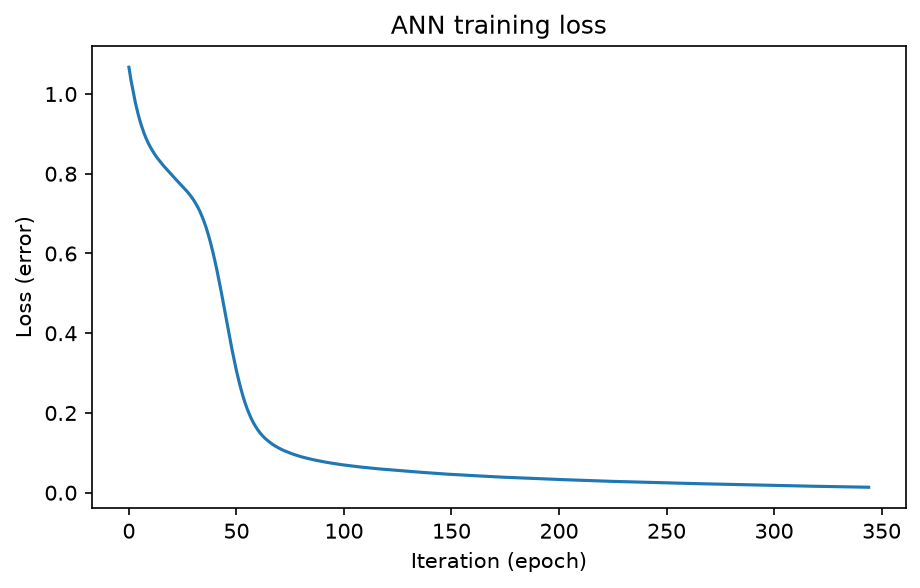
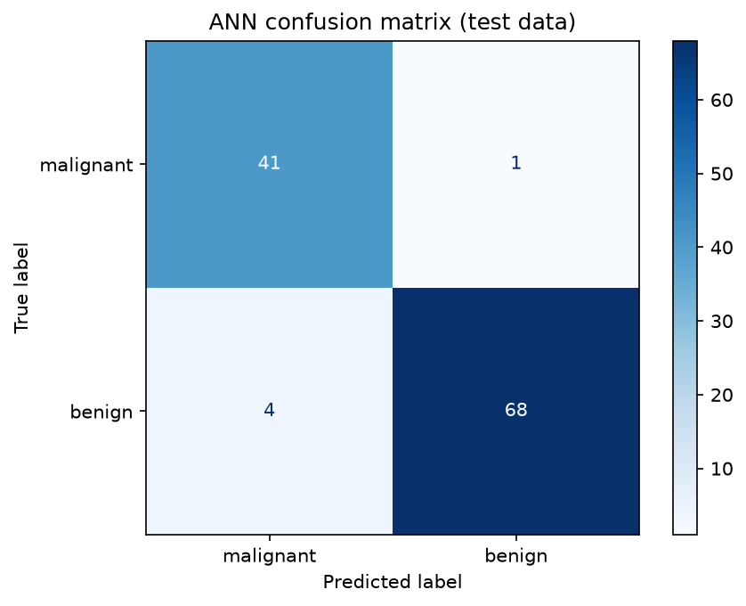

# Artificial Neural Network (ANN)

**Author:** Bakhtawar Ali

## Objective
To build an Artificial Neural Network that classifies breast tumours as
malignant or benign, and to evaluate it on unseen data.

## Algorithm in Simple Words
An ANN is made of layers of small units called neurons. Each neuron
multiplies its inputs by weights, adds them up, and passes the result
through an activation function. During training the network compares its
prediction with the true answer, measures the error (loss), and adjusts the
weights a little (backpropagation with the Adam optimizer). This repeats
until the error is small.

## Dataset
Breast Cancer Wisconsin (built into scikit-learn): 569 patients,
30 numeric tumour measurements, target = malignant (212) or benign (357).
Split: 80% training (455 rows), 20% testing (114 rows), stratified,
random_state = 42. A copy is saved in `data/breast_cancer.csv`.

## Network Architecture
| Layer | Neurons | Activation |
|---|---|---|
| Input | 30 | none |
| Hidden 1 | 16 | ReLU |
| Hidden 2 | 8 | ReLU |
| Output | 1 | Logistic (sigmoid) |

Optimizer: Adam. Features were standardized with StandardScaler (fitted on
training data only, to avoid data leakage). Training stopped after 345
iterations.

## Tools Used
Python 3.11, pandas, scikit-learn (MLPClassifier), matplotlib.

## How to Run (Mac)
```bash
git clone https://github.com/Bakhtawar560/ann-neural-network.git
cd ann-neural-network
python3 -m venv venv
source venv/bin/activate
pip install -r requirements.txt
mkdir -p data
python3 src/ann.py
```

## Results
| Metric | Value |
|---|---|
| Train accuracy | 99.78% |
| **Test accuracy** | **95.61%** |
| Malignant: precision / recall / F1 | 0.91 / 0.98 / 0.94 |
| Benign: precision / recall / F1 | 0.99 / 0.94 / 0.96 |

Training loss curve:



Confusion matrix on the 114 test patients:



### Experiment: network size
| Hidden layers | Train % | Test % |
|---|---|---|
| (4,) | 98.68 | 95.61 |
| (8,) | 99.12 | 96.49 |
| (16, 8) | 99.78 | 95.61 |
| (32, 16) | 100.00 | 95.61 |

A bigger network fits the training data better, but test accuracy did not
improve, so a small

cat > README.md << 'EOF'
# Artificial Neural Network (ANN)

**Author:** Bakhtawar Ali

## Objective
To build an Artificial Neural Network that classifies breast tumours as
malignant or benign, and to evaluate it on unseen data.

## Algorithm in Simple Words
An ANN is made of layers of small units called neurons. Each neuron
multiplies its inputs by weights, adds them up, and passes the result
through an activation function. During training the network compares its
prediction with the true answer, measures the error (loss), and adjusts the
weights a little (backpropagation with the Adam optimizer). This repeats
until the error is small.

## Dataset
Breast Cancer Wisconsin (built into scikit-learn): 569 patients,
30 numeric tumour measurements, target = malignant (212) or benign (357).
Split: 80% training (455 rows), 20% testing (114 rows), stratified,
random_state = 42. A copy is saved in `data/breast_cancer.csv`.

## Network Architecture
| Layer | Neurons | Activation |
|---|---|---|
| Input | 30 | none |
| Hidden 1 | 16 | ReLU |
| Hidden 2 | 8 | ReLU |
| Output | 1 | Logistic (sigmoid) |

Optimizer: Adam. Features were standardized with StandardScaler (fitted on
training data only, to avoid data leakage). Training stopped after 345
iterations.

## Tools Used
Python 3.11, pandas, scikit-learn (MLPClassifier), matplotlib.

## How to Run (Mac)
```bash
git clone https://github.com/Bakhtawar560/ann-neural-network.git
cd ann-neural-network
python3 -m venv venv
source venv/bin/activate
pip install -r requirements.txt
mkdir -p data
python3 src/ann.py
```

## Results
| Metric | Value |
|---|---|
| Train accuracy | 99.78% |
| **Test accuracy** | **95.61%** |
| Malignant: precision / recall / F1 | 0.91 / 0.98 / 0.94 |
| Benign: precision / recall / F1 | 0.99 / 0.94 / 0.96 |

Training loss curve:


Confusion matrix on the 114 test patients:


### Experiment: network size
| Hidden layers | Train % | Test % |
|---|---|---|
| (4,) | 98.68 | 95.61 |
| (8,) | 99.12 | 96.49 |
| (16, 8) | 99.78 | 95.61 |
| (32, 16) | 100.00 | 95.61 |

A bigger network fits the training data better, but test accuracy did not
improve, so a small network is enough for this dataset.

## Conclusion
The ANN reached about 95.6% accuracy on patients it had never seen. Only one cancer was missed, which matters because missing a cancer is the more serious mistake. Making the network bigger raised training accuracy to 100% but did not help on test data, which is a sign of overfitting. The dataset is small, so the result is a good example but not proof for real medical use.
